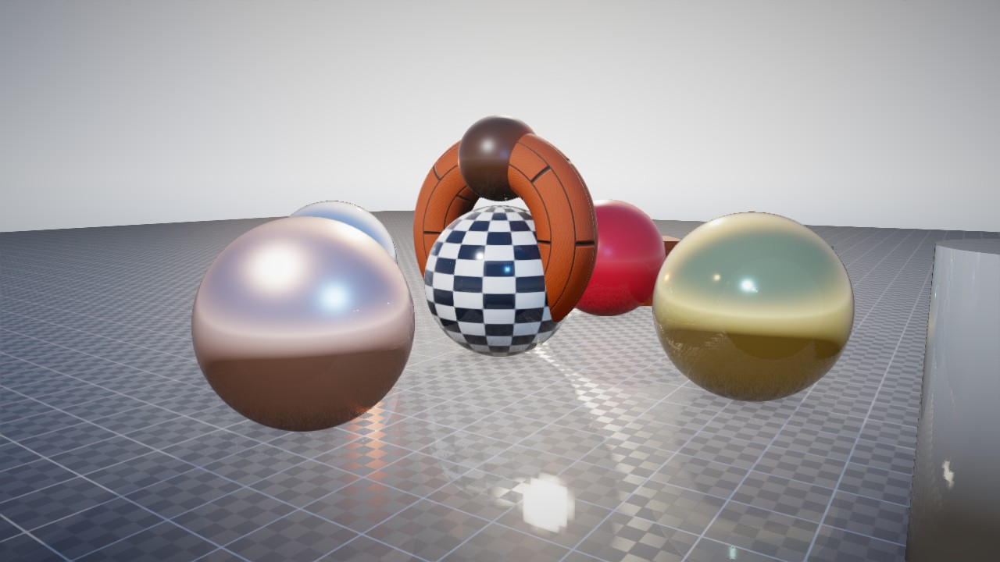

# kast

[](https://crates.io/crates/kast-render)
[](https://docs.rs/kast-render)
[](#license)

A photorealistic real-time renderer for Rust, built on [`wgpu`](https://wgpu.rs). One deferred
pipeline that does the whole frame — geometry, image-based lighting, soft sun shadows, ambient
occlusion, reflections, bloom, depth of field, tonemapping, antialiasing, fog — in ~6k lines of
readable Rust with the WGSL beside it.

Ships as a library (`kast`) and as a small viewer binary (`kast`) that opens a window on a
built-in demo scene or any glTF 2.0 model, and can also render offscreen to a PNG.

> Published as **`kast-render`** because the name `kast` is taken on crates.io by an unrelated
> project. The library crate is still `kast`, so `use kast::...` works unchanged — or alias the
> dependency: `kast = { version = "0.1", package = "kast-render" }`.



## Features

- **Deferred PBR pipeline** — albedo / normal / emissive / reversed-Z depth G-buffer, metallic-
  roughness shading with the GGX distribution, Smith geometry (Schlick-GGX) and a Schlick
  Fresnel term.
- **Image-based lighting** — a procedural sky is prefiltered on the GPU into an irradiance cube
  and a roughness mip chain, so ambient light and reflections follow the sky you set.
- **Four-cascade sun shadows** with percentage-closer soft shadows: penumbra width follows the
  gap between blocker and receiver (`Settings::shadow_softness`), cascades blend at their edges,
  and `Settings::shadow_distance` caps the range for very large far planes.
- **SSAO** with a separable blur and a debug view, **screen-space reflections** with
  configurable step count and intensity, and **physically-motivated bloom** (prefilter /
  downsample / upsample chain).
- **Post**: depth of field (focus distance + range), ACES (Narkowicz or fitted), Reinhard or
  clamped tonemapping, exposure in EV, vignette, FXAA.
- **Atmosphere**: exponential height fog / aerial perspective tinted from the sky at the horizon,
  with optional sun in-scatter glow.
- **Transparency**: per-object alpha drawn with ordered dithering, so it needs no depth sort.
- **Scene**: 64 punctual lights (directional, point, spot with cone angles), per-object
  transform / visibility / alpha / shadow casting, frustum culling, 16x anisotropic filtering.
- **glTF 2.0** loading (`.gltf` and `.glb`) with PBR material maps and the
  `KHR_lights_punctual`, `KHR_materials_emissive_strength`, `KHR_materials_unlit` and
  `KHR_texture_transform` extensions.
- **Camera**: orbit and fly modes, full 3-axis orientation (roll) for cockpit / chase views, and
  a reversed-Z infinite projection so a 100 km far plane keeps depth precision up close.

## Install the viewer

```sh
cargo install kast-render
kast                       # demo scene, interactive window
kast --model model.glb     # load a glTF/GLB model
kast -o frame.png          # render offscreen to PNG (implies --headless)
```

### Options

```
-m, --model <PATH>       Load a glTF/GLB model instead of the demo scene
    --headless           Render without a window
-o, --screenshot <PATH>  Render a frame and save it as PNG (implies --headless)
-n, --frames <N>         Frames to render in headless mode (default 30)
    --width <PIXELS>     Offscreen width (default 1280)
    --height <PIXELS>    Offscreen height (default 720)
    --no-ssao / --no-ssr / --no-shadows / --no-ibl / --no-bloom
    --dof                Enable depth of field
```

### Controls

```
RMB drag   rotate camera (orbit / fly)      Tab     toggle orbit / fly
MMB drag   pan                              W A S D move
wheel      zoom (orbit) / speed (fly)       Q E     down / up
[ ]        exposure down / up               Esc     quit
F1..F6     toggle SSR / SSAO / shadows / IBL / DoF / FXAA
F7         cycle tonemapper
```

## Library use

Add the package; the crate is imported as `kast`:

```toml
[dependencies]
kast-render = "0.1"
```

`wgpu` and `glam` are re-exported as `kast::wgpu` and `kast::glam`, so you can build against the
exact versions the renderer uses instead of pinning your own.

```rust
use kast::camera::Camera;
use kast::context::GpuContext;
use kast::renderer::Renderer;
use kast::scene;

fn main() -> anyhow::Result<()> {
    let (width, height) = (1280, 720);

    // Device, queue and (optionally) a window surface.
    let ctx = pollster::block_on(GpuContext::new_headless(width, height))?;

    // A scene of meshes, materials, objects, lights and sky.
    let mut scene = scene::default_scene(&ctx.device, &ctx.queue)?;

    // Created once; rebuilt only when the target format changes.
    let mut renderer = Renderer::new(
        &ctx.device,
        &ctx.queue,
        width,
        height,
        ctx.target_format,
        ctx.srgb_target,
        /* headless */ true,
        &mut scene,
    )?;

    // Every effect is a live field — no pipeline rebuild.
    renderer.settings.exposure_ev = 0.3;
    renderer.settings.shadow_softness = 0.05;
    renderer.settings.fog_enabled = true;

    let camera = Camera::default();
    renderer.render(&ctx.device, &ctx.queue, &scene, &camera, None, 1.0 / 60.0);
    Ok(())
}
```

In a windowed app, pass `Some(&view)` as the `present` argument to `Renderer::render` and call
`Renderer::resize` when the surface size changes. `examples/offscreen.rs` is a complete runnable
program that renders the demo scene and writes a PNG:

```sh
cargo run --example offscreen -- frame.png
```

### Building a scene by hand

```rust
use kast::glam::{Mat4, Vec3};
use kast::material::{MaterialDesc, MaterialMaps};
use kast::scene::{self, Light, SceneObject};

let mesh = scene.add_mesh(&ctx.device, "sphere", geometry::uv_sphere(1.0, 64, 48));
let material = scene.add_material(
    &ctx.device,
    &ctx.queue,
    MaterialDesc { base_color: [0.9, 0.2, 0.1, 1.0], roughness: 0.25, ..Default::default() },
    MaterialMaps::default(),
)?;
scene.objects.push(SceneObject::new(mesh, material, Mat4::IDENTITY));
scene.lights.push(Light::point(Vec3::new(0.0, 2.0, 0.0), Vec3::ONE, 40.0, 12.0));
```

`Scene` is plain data with public vectors, so objects and lights can be pushed, mutated or
removed between frames; the renderer re-uploads only what changed
(`Renderer::update_objects`).

## Requirements

- Rust 1.85+ (edition 2024).
- A `wgpu` backend: Vulkan or GL on Linux, Metal on macOS, DX12 on Windows.
- For the viewer: a window system (`winit`); headless rendering needs no display server but still
  needs a working Vulkan/GL driver (Mesa `lavapipe` or `llvmpipe` is enough for CI).

## Notes and limitations

- The pipeline targets a desktop-class GPU; the G-buffer is 4 render targets at full resolution.
- Shadows cover one directional (sun) light — punctual lights do not cast shadows yet.
- Reflections are screen-space only: geometry off-screen or behind the camera is not reflected.
- The demo scene is procedural (no external assets); models are loaded from glTF.

## License

Dual-licensed under either of

- MIT License ([LICENSE-MIT](LICENSE-MIT))
- Apache License 2.0 ([LICENSE-APACHE](LICENSE-APACHE))

at your option. Unless you explicitly state otherwise, any contribution intentionally submitted
for inclusion in this crate by you, as defined in the Apache-2.0 license, shall be dual licensed
as above, without any additional terms or conditions.
